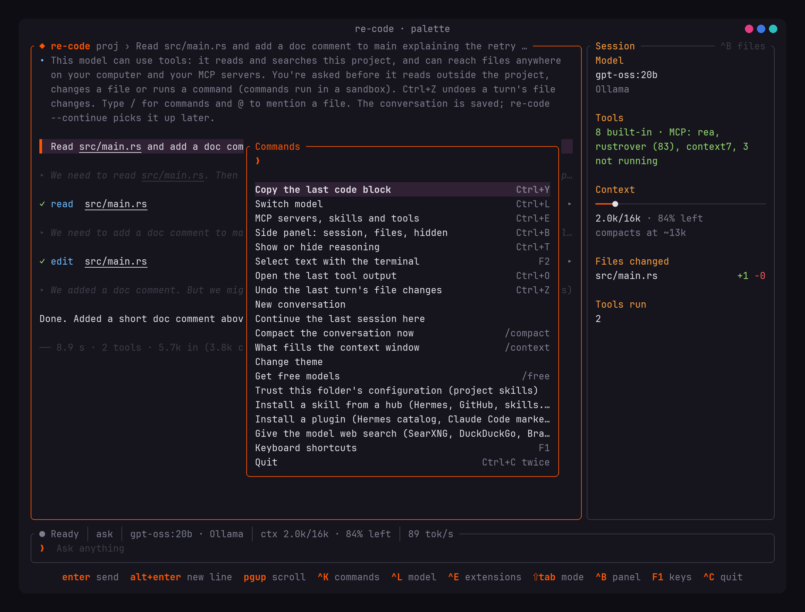

<p align="center">
  
</p>

<h1 align="center">re-code</h1>

<p align="center"><strong>A coding agent for your own machine.</strong><br>
Terminal-native. Written in Rust. Local models first.<br>
It reads, searches, edits and writes your files with your approval, runs commands in a sandbox, and uses the MCP servers, skills and plugins you already have.</p>

<p align="center">
  <a href="https://github.com/ZeroDay-Labz/Re-Code/releases/latest"></a>
  <a href="LICENSE"></a>
  
  
  
</p>

<p align="center">
  
</p>

<p align="center"><em>Every screenshot in this README was captured from the real program driving a local model, by <code>scripts/screenshots/capture.sh</code>.</em></p>

---

**Contents** · [What it is](#what-it-is) · [Why](#why-re-code) · [Install](#install) · [Your first session](#your-first-session) · [A look around](#a-look-around) · [Features](#features) · [Configuration](#configuration) · [Command line](#the-command-line) · [Keys and commands](#keys-and-commands) · [Troubleshooting](#troubleshooting) · [Security](#security) · [Architecture](#architecture) · [Status](#status) · [Development](#development)

## What it is

re-code is an AI coding agent that lives in your terminal, like Claude Code or OpenCode, built so that **the model running on your own GPU is the first-class citizen**. You open it in a project folder, pick a model your Ollama (or llama.cpp, vLLM, LM Studio) is serving, and ask for work. The model reads your code, searches it, proposes edits as diffs you approve, runs tests in a sandbox, uses git, and reaches your MCP servers. The conversation is saved as it happens and compacted when it grows; every token that goes to the model is accounted for and shown to you.

It also talks to cloud providers when you want them, with keys in your system keyring and a clear line between what is free on your account and what is billed. And it reaches into the ecosystems you already use: the MCP servers configured in Claude Code are used live, skills install from the Hermes index, GitHub and skills.sh, plugins from the Hermes catalog and Claude Code marketplaces, and OpenCode's configuration imports in one key.

**Who it's for.** People who run models locally and want an agent that is honest about what those models can and can't do; people who already have an MCP, skills and plugins setup in another tool and don't want to rebuild it; and anyone who wants to see exactly what an agent is about to do to their files before it does it.

## Why re-code

Most local-model agents fail for reasons that have nothing to do with the model: prompts silently truncated, a thirty-second model load with no feedback, tool calls in a dialect the client can't parse, and tens of thousands of tokens of overhead before you've typed a word. re-code is built around those failures.

- **Every token is accounted for.** Each request has an itemised ledger (`/context`), and estimates are always labelled separately from what the provider reported. A runtime that reports far fewer prompt tokens than were sent is called out as probably truncating.
- **It asks before it acts.** Edits, writes, deletes and commands wait for you, with a live diff. Say yes once, for the session, or for the project. Ctrl+Z takes a turn's file changes back; Esc Esc rewinds further.
- **It respects what you already run.** It finds your runtimes, podman pods and systemd units, and never starts, stops or reconfigures them without asking. Your Ollama is yours.
- **It reaches what Claude Code reaches, on your models.** Claude Code's MCP servers are used live. Skills and plugins come from the hubs you know. Everything is fetched without running anything, scanned, and shown to you first.
- **It tells you what's actually happening.** Loading a model, evaluating the prompt and generating are different states, and the interface shows which one you're in. Free means free: a model priced per request isn't called free because its per-token price is zero.
- **It fits any terminal.** The interface is property-tested across thousands of sizes down to 30×12, and it keeps the keys you can press on screen at all times.

## Install

Packages for Fedora and Debian/Ubuntu are on the [releases page](https://github.com/ZeroDay-Labz/Re-Code/releases):

```sh
sudo dnf install ./re-code-*.x86_64.rpm     # Fedora
sudo apt install ./re-code_*_amd64.deb      # Debian 12, Ubuntu 22.04 or newer
```

Or build from source with a current stable Rust toolchain:

```sh
git clone https://github.com/ZeroDay-Labz/Re-Code.git
cd Re-Code
cargo install --path crates/app
```

**You'll want:**

| | Why |
| --- | --- |
| [Ollama](https://ollama.com) (or llama.cpp, vLLM, LM Studio) with a **tool-capable model** such as `gpt-oss:20b`, `qwen3` or `llama3.2` | The agent needs a model that declares tool calling. The Models tab shows which do. |
| `bubblewrap` (`sudo dnf install bubblewrap`) | Every command the agent runs is sandboxed with it. Without it, commands still ask, and the interface says plainly that they'd run unsandboxed. |
| `git` | For the `git` tool and for projects that are repositories. |
| Node.js and/or `uv` | Only if you install MCP servers, skills or plugins that run on them. |

## Your first session

```sh
cd your-project
re-code
```

1. **The home screen** opens on your models (or on your saved chats, once you have some). Pick a model with the arrow keys and Enter. The Models tab tells you each model's real size, what it declares (tools, vision, thinking), and whether it fits your free GPU memory.
2. **Ask for something.** `Read src/main.rs and add a doc comment to main explaining the retry loop.` The model reads the file (a read-only tool runs without asking), then proposes an edit.
3. **The approval card** shows the diff. Press `y` to apply it once, `a` to allow edits for the rest of the session, `p` to remember the grant for this project, `n` to deny, or `d` to see the whole diff. The side panel keeps count of context left and files changed.
4. **The turn ends** with a footer: how long it took, how many tools ran, and the tokens the provider reported, cached ones separately.
5. **Keep going.** Type while the model works and your message queues. `/context` shows what fills the next request. Ctrl+Z undoes the turn's file changes if you change your mind. Quit with Ctrl+C twice; the session is saved, and `re-code --continue` picks it up.

Useful first commands:

```
/web                 give the model web search (your SearXNG, DuckDuckGo, Brave, …)
/skill install official/security/godmode     a skill from the Hermes index, previewed first
/plugin marketplace add anthropics/claude-plugins-official
/init                write a first RE-CODE.md for this project from what the tree shows
re-code doctor       what re-code found on this machine, and why
```

## A look around

| | |
| --- | --- |
| **Home.** Saved chats to continue (or delete), the last model, free models to try, and live GPU and memory meters.  | **Models.** Every model your runtime serves with its real size, what it declares, whether it fits your GPU, and the context memory estimated on top of the weights. Grouped: on this computer, free, paid per provider, needs a key.  |
| **A turn.** Tool calls as rows, reasoning folded to one line, and a footer with the provider's own token figures.  | **Context.** `/context` breaks the next request down part by part and names the largest tool results.  |
| **Runtimes.** Found through podman, docker, systemd and the processes actually answering; Enter on a stopped one shows the exact start command.  | **MCP.** Your servers plus the ones set up in Claude Code, used live; the registry is one key away, OpenCode's servers import with another.  |
| **Skills from hubs.** Fetched, scanned and shown before anything is installed.  | **Plugins.** A marketplace plugin previewed in Hermes' words: what runs here, what doesn't.  |
| **Plugins tab.** Installed plugins, followed marketplaces, and what Claude Code itself has installed.  | **Skills tab.** Yours, the project's (off until trusted), Claude Code's, each with its scan verdict.  |
| **Command palette.** Ctrl+K for everything, recent commands first.  | **Themes.** Eleven palettes with dim and bright variants, previewed live; your own theme files hot-reload.  |

## Features

### Reading the Models tab

Each local model has a mark, from the model's size against the GPU memory that is free right now:

| Mark | Means |
| --- | --- |
| `●` green | Fits your GPU with room to spare: it should run entirely on the GPU. |
| `◐` yellow | Partly on the CPU: the weights are larger than the free GPU memory, so some layers run slowly on the CPU. The details pane says by how much. |
| `○` red | Larger than your available memory altogether. It probably won't load. |
| `·` grey | Your GPU's free memory isn't known (no GPU, or a driver that doesn't report it), so there's no estimate. |
| `☁` | A cloud model: it runs on the provider's servers. |

A dimmed row is a model that doesn't declare tool calling: it can chat, but it can't read or change files. The chips after the name (`tools`, `vision`, `thinking`) are what the model declares, not what has been tested, until it has been used. The estimate counts the context's key/value cache on top of the weights, so a model that fits at 16k may show as partly on the CPU at 64k.

### Models and runtimes

- **Local first.** Ollama is native. llama.cpp, vLLM and LM Studio are found by what they answer. `re-code doctor` explains each one: which container or systemd unit serves it, whether it has GPU devices, and the exact command that would start it. Nothing is started without your `y`; `a` instead starts it now and every time re-code opens, as long as the command stays the same.
- **Honest model facts.** Sizes come from the runtime. Tool, vision and thinking support is shown as *declared* until a model is tested. Context limits come from the model's own metadata, and the memory its key/value cache needs is estimated per context size, so "fits your GPU" means with the context you'd actually use.
- **Cloud when you want it.** Anthropic (native), OpenAI, Google Gemini, OpenRouter and any OpenAI-compatible endpoint, with presets for Ollama Cloud, NVIDIA, Hugging Face, Mistral, DeepSeek, Together, Fireworks, Moonshot, Z.AI, MiniMax, xAI, Novita, Groq and more. Keys live in the system keyring, never in a file.
- **Free means free.** OpenRouter's free models are listed with their real facts from its own listing, and its daily allowance is shown after connecting ("3 of 50 requests used today; no credits bought yet"). A model that is $0 per token but charges per request is not called free. Paid models are grouped per provider, so what your Gemini key pays for isn't mixed with what your OpenRouter key pays for.
- **Switch mid-session.** Ctrl+L changes model; the conversation carries on and the ledger keeps counting.

### The agent

- **Tools:** `read` (with paging), `list`, `grep`, `write`, `edit`, `delete`, `shell`, `git`, a `todo` list, a `task` helper, `memory`, `skill`, and MCP. Read-only tools run on their own; the rest ask.
- **Approvals with a diff.** `y` once, `a` for the session, `p` remembered for the project, `n` deny, `d` the whole diff. Permission modes cycle with Shift+Tab: **ask**, **accept edits** (edits inside the project run without asking; deletes, commands and anything outside still ask), **plan** (reading tools plus a `plan` tool that writes outside the project; `/plan` shows it), and **auto** inside the sandbox.
- **The sandbox.** Commands run under bubblewrap: the project writable, everything else read-only, your home emptied except toolchains, secrets and `/run` hidden, no network unless the model asks and you approve, a scrubbed environment, its own PID namespace, a ten-minute limit, killed on Esc. Measured at about 6 ms of overhead per command.
- **Files anywhere, scoped.** The agent can reach outside the project with approval. Grants can be exact, project-wide for edits or deletes, or a whole folder (`--add-dir`). Files that look like secrets always ask, and the approval shows the real target of a symlink.
- **Undo and rewind.** Ctrl+Z takes back a turn's file changes. Esc Esc (or `/rewind`) goes back to an earlier request: conversation only, conversation and files, or with a summary of what was removed kept in place.
- **Type while it works.** Enter queues your message; it reaches the model after the current tool calls. Ctrl+Enter stops the turn and sends now. `!command` runs something yourself in the sandbox (`!!` with network, a trailing `&` for the background), and the model hears the tail of the output.
- **Helpers.** The `task` tool delegates a self-contained job to a helper conversation on the same model with its own empty context and reading tools by default; only its answer comes back. Background commands keep running while you work (`/tasks`).

### Context you can see

- `/context` shows what fills the next request: system prompt, memory, skills index, tool definitions, conversation, tool results and shortened results, with the three largest tool results named. `/context raw` shows the request itself with secrets hidden.
- **Compaction is preflighted on every request.** From a threshold (80% of the budget by default), old tool results shrink to handles that a `read_result` tool can bring back, then older messages are summarised by the model with the objective, the current request and the recent steps kept verbatim. After a summary the model gets its task list, the files it was working on and the skills it had loaded back as notes. Three summaries in one turn stop the turn with an explanation instead of thrashing.
- `/compact <focus>` steers summaries; `/compactions` lists what each one kept and replaced, with the replaced messages kept in the database; `/autocompact 100k|auto|off` sets where it starts. Idle compaction is opt-in on the Settings tab.
- **Each model has a context window re-code budgets against,** tunable on the Settings tab. Local models get `num_ctx` capped at the model's own limit; cloud models their listed limit. Estimates calibrate themselves per model from the tokens the provider reports.
- One tool result can never fill the window: results are cut at a quarter of it, with the whole text a `read_result` away, and `read` pages with `offset` and `limit`.

### MCP

- **Your servers, plus Claude Code's,** configured in `~/.claude.json` at user and project scope and in approved `.mcp.json` files, used live with their tool schemas. OpenCode's servers import with `o` (keys are never copied; `{env:VAR}` becomes a `${VAR}` reference).
- **Discover-then-call by default,** so a 200-tool server costs a small index: the model lists a server's tools, then calls one. Expose a server's tools directly with `x` when it's small. Per-server tool filters (`f`) the model can't bypass.
- **Add anything:** a command line, an `http(s)://` address, a registry id (`io.github.owner/server`), a `server.json` link, a GitHub repo, or a pasted config snippet from any other tool. Search the official registry with `s`. Failures are diagnosed in plain words ("Nothing is answering at …").
- **Stdio servers run in bubblewrap** by default, with the project writable, package caches bound back, and the server's key passed in with `--setenv` so only that process sees it. A server that needs the host can opt out in its form, and the row says `unsandboxed`.
- **`/web`** gives the model web search through a server of your choice: your own **SearXNG** by address, **DuckDuckGo** and a **page reader** without a key, your own **Firecrawl** by address, or **Brave**, **Tavily** and **Exa** with a key. The form opens prefilled.

### Skills

- Skills follow the [Agent Skills](https://agentskills.io) format: a folder with a `SKILL.md`. A small index goes in the prompt; a skill's instructions load only when a task matches, or when you type `/skill-name`.
- **Scanned before they can be enabled** for piped-to-shell downloads, decode-and-execute, destructive deletes, credential reads, exfiltration of environment variables, prompt-injection phrases and invisible characters. A `dangerous` verdict can't be overridden; `caution` is shown with its findings. A project's skills stay off until you `/trust` the folder, and trust is pinned to the folder's content.
- **Install from hubs:** `/skill install official/security/godmode`, a bare name looked up in the Hermes index (100k skills, which also covers ClawHub, skills.sh and LobeHub listings), `owner/repo/folder[@ref]`, a GitHub, skills.sh or `SKILL.md` link, or a folder. Nothing fetched is executed and no git runs: files come through GitHub's tree listing into a staging folder, are scanned, and are shown with the pinned commit, what the skill declares (tools, scripts, environment variables), its size and the verdict. `y` enable, `k` keep off, `n` discard, `r` read the file.
- **Whole lists, with tick boxes.** Point it at a repository or a Hermes category (`/skill install official/security`, `/skill install anthropics/skills`) and every skill in it is listed: `space` ticks one, `a` ticks them all, Enter fetches the ticked set into a checklist that shows each one's verdict as it lands, and `y` installs what's ticked (a dangerous one stays off). Search hits tick with `tab` and `^a`. A repository that is itself a skill but too large to take whole (a monorepo with evals and tooling around it) offers its skill folders instead.
- **Paste.** With the install prompt open, paste several links or names (one per line) for a checklist, or paste a `SKILL.md` itself: it's staged from the text, scanned and previewed like anything else, and recorded as pasted so `u` knows there's nowhere to update it from.
- **Updates.** Each installed skill records where it came from and which commit. `u` fetches the newest one and lists the files that would change before replacing anything.

### Plugins

- From the **Hermes plugin catalog** (1,200 plugins: `/plugin install better-session-appearance`), **Claude Code marketplaces** you follow (`/plugin marketplace add anthropics/claude-plugins-official`, then `b` to browse or `name@marketplace`), GitHub, or a folder, including what Claude Code itself has installed (listed read-only; Enter brings one over).
- **Browse by category.** The catalog browser (`b` on the Plugins tab) shows Hermes' categories (tools, desktop, models, memory, general, automation, web, platform, voice) on a line: `←`/`→` move along it, typing filters within it, `tab` ticks a plugin, `^a` ticks everything shown, and Enter fetches the ticked set into one checklist. A checklist takes 25 at a time, because each plugin is at least one GitHub listing and GitHub allows 60 an hour without a `GITHUB_TOKEN`.
- **The preview uses Hermes' own words:** `name [tier] pinned @ sha · maintained by …`, then what runs here and what doesn't. A plugin's skills and command files become skills; its `mcp.json` servers join the MCP tab. Python code, desktop parts, agents and LSP servers are listed as not run. Claude Code hooks are translated into a file beside the plugin for you to read and copy, never loaded on their own. Marketplace sources that execute code on install (`npm`, `command`) are refused with the reason.

### Memory and instructions

- **Instruction files.** `RE-CODE.md`, `AGENTS.md` and `CLAUDE.md` are read at user and project level with `@path` imports, so a project set up for another agent works as it is. Project files load after `/trust`. `/init` writes a first one from what the tree proves (crates, scripts, make targets); `/memory` lists what's in force and its cost; a message starting `# ` is a note appended to a file you choose.
- **Memory of its own.** The model saves facts with a `memory` tool (after approval, or always once you've pressed `a` or `p`): facts about you, corrections, project decisions that aren't in the code. Later sessions get them back in the prompt. Project and user scopes, files in re-code's data folder you can read and edit, a Settings row for on, read-only or off, and `--no-memory` for scripts.

### Sessions

Every session is saved as it happens: the event log plus a snapshot of the exact conversation after each turn. `re-code --continue` or `/continue` picks one up, including after a crash, with the model told what it missed. Chats can be deleted from the Home list or the picker. `/export [path|clipboard]` writes the conversation as Markdown; Ctrl+X opens it as a searchable transcript, and `[` writes it into your terminal's own scrollback so native search and tmux copy mode work on it.

### Automation

- **Headless.** `re-code -p "prompt"` runs one request without the interface, with `--output-format text|json|stream-json`, `--model`, `--max-turns`, `--allowed-tools` and `--permission-mode`. Exit codes: 0 done, 1 failed, 2 a tool that needed approval was denied, 3 no such model. `-` reads the prompt from stdin.
- **Hooks** from `~/.config/re-code/hooks.toml` and a trusted project's `.re-code/hooks.toml`: `pre_tool_use` (block, change the arguments, add context), `post_tool_use`, `stop` (send words back as the next request, twice at most) and `session_start`. JSON on stdin; project hooks run in the sandbox.
- **The same management from the shell.** See [The command line](#the-command-line).

### The interface

- Fits any terminal size, checked by property tests across thousands of sizes. A legend of the keys you can press is always on screen.
- Drag to select and copy anywhere on screen (clipboard and primary selection); double-click a word, triple-click a message; middle-click pastes. F2 hands the mouse to your terminal for its own selection.
- A side panel with the session (model, tools, context left, files changed, tasks) or the project tree; folders fold, files open in `$EDITOR`. Project paths in the conversation are underlined and clickable.
- Eleven themes (Driftwave, Catppuccin, Tokyo Night, Gruvbox, Nord, Dracula, Rosé Pine, Solarized, …) with dim and bright variants and an accent override, and your own TOML theme files that hot-reload. A light theme is detected from the terminal.
- Toasts, desktop notifications when a turn needs you while the window is unfocused, a reduced-motion spinner, flicker-free streaming, and a live output graph while the model is working.

## Configuration

re-code never writes `config.toml`; everything else it manages itself. Keys are in the system keyring.

| Path | Holds |
| --- | --- |
| `~/.config/re-code/config.toml` | Ollama address, default context size, theme |
| `~/.config/re-code/extensions.toml` | MCP servers, providers (no keys), custom tools, followed marketplaces, on/off choices |
| `~/.config/re-code/skills/` | Your skills, one folder each |
| `~/.config/re-code/themes/` | Your theme files |
| `~/.config/re-code/hooks.toml` | Your hooks |
| `~/.config/re-code/RE-CODE.md` | Your own instructions, read with every request |
| `~/.local/share/re-code/` | Sessions (`re-code.sqlite3`), installed plugins, memory, plan files |
| `~/.cache/re-code/` | The models.dev catalog, hub indexes, install staging |
| `~/.local/state/re-code/logs/` | Logs |
| `.re-code/` in a project | Project skills, hooks and `instructions.md`, off until trusted |

**`config.toml`**

```toml
[ollama]
url = "http://localhost:11434"
num_ctx = 16384              # the context size sent with every request; the Settings tab can override it per model

theme = "auto"               # auto | dark | light | a theme name, e.g. "nord:bright+#ff8800"
```

**`extensions.toml`** is written by re-code; this is what it looks like, so you know what you're trusting:

```toml
[[mcp]]
name = "searxng"
type = "stdio"
command = "npx"
args = ["-y", "mcp-searxng@latest"]
enabled = true

[mcp.env]
SEARXNG_URL = "http://10.0.0.63:8888"        # ${VARIABLE} reads from the environment instead

[[provider]]
name = "openrouter"
kind = "openai_compatible"
base_url = "https://openrouter.ai/api/v1"
enabled = true                                 # the key is in the keyring, not here

[[marketplace]]
name = "claude-plugins-official"
repo = "anthropics/claude-plugins-official"
sha = "0412be76f50ab4f4f8abff3753efa9269fbbca5b"
```

**`hooks.toml`**

```toml
[[hook]]
event = "pre_tool_use"          # pre_tool_use | post_tool_use | stop | session_start
tools = ["shell", "edit"]       # optional: only these tools (globs allowed)
command = "scripts/check-edit.sh"
timeout_secs = 30
```

The hook gets JSON on stdin (`event`, `project`, `mode`, `tool`, `output`, `result`). Exit 0 continues, exit 2 blocks with stderr going to the model. Stdout may be JSON: `{"decision": "block", "reason": "…", "updated_input": {…}, "add_context": "…"}`.

**A theme file**, `~/.config/re-code/themes/ember.toml`:

```toml
name = "Ember"
inherit = "Gruvbox"      # start from a built-in, change what you list
borders = "square"       # rounded | square
density = "compact"      # roomy | compact

[colors]                 # any of the 14 tokens, #rrggbb
accent = "#ff8800"
```

**A skill**, `~/.config/re-code/skills/release-notes/SKILL.md`:

```markdown
---
name: release-notes
description: Write release notes from the git log. Use when asked for a changelog or release notes.
---

Run `git log --oneline <last tag>..HEAD`, group the commits by area, and write …
```

## The command line

Everything the home screen does, from the shell. Lists take `--json`; installs print the same preview as the interface and ask, or take `--yes` / `--keep-off`.

```sh
re-code                                  # the program, in the current project
re-code --continue                       # pick up the last session here
re-code --add-dir ~/notes                # let the agent reach another folder for this session
re-code -p "summarise src/lib.rs" --output-format json --max-turns 8
re-code doctor [--json]                  # this machine: runtimes, containers, GPU, what would start what

re-code mcp list|add|remove|enable|disable|test|import claude|opencode
re-code mcp add --name ide http://127.0.0.1:64522/stream
re-code mcp add "npx -y mcp-searxng@latest" --name searxng

re-code skill list|search|install|update|remove|enable|disable
re-code skill install official/security/godmode --keep-off
re-code skill install anthropics/skills/skills/pdf anthropics/skills/skills/xlsx --yes   # several at once

re-code plugin list|search|install|update|remove|enable|disable
re-code plugin marketplace add|list|remove|browse
re-code plugin marketplace add anthropics/claude-plugins-official
re-code plugin install context7@claude-plugins-official --yes

re-code memory list|show|forget
re-code trust [path] [--yes]             # trust a project folder's configuration as it is now
re-code untrust [path]
re-code completions bash|zsh|fish
```

Exit codes: 0 done, 1 error, 2 refused (a dangerous skill, an unsupported source, something that isn't there), 4 a decision was needed and there was no terminal to ask.

## Keys and commands

| Key | Does |
| --- | --- |
| `Enter` / `Alt+Enter` | Send / new line |
| `Esc` | Stop the agent, or close a window; twice to rewind |
| `Ctrl+K` | Command palette |
| `Ctrl+L` / `Ctrl+E` | Switch model / MCP, skills, plugins, tools |
| `Shift+Tab` | Permission mode: ask, accept edits, plan, auto |
| `Ctrl+B` | Side panel: session, files, hidden |
| `Ctrl+T` / `Ctrl+O` | Show reasoning / last tool output |
| `Ctrl+Z` / `Ctrl+Y` | Undo the last turn's file changes / copy the last code block |
| `Ctrl+R` / `Ctrl+X` | Search earlier prompts / transcript mode |
| `y` `a` `p` `n` `d` | On an approval: once, this session, this project, deny, diff |
| `/` and `@` | Commands, and mention a file (its text is attached) |
| `# note` | Append a line to an instruction file |
| `F1` | Every key, in the program |

| Command | Does |
| --- | --- |
| `/context [raw]`, `/compact [focus]`, `/compactions`, `/autocompact <size>` | The context window and compaction |
| `/mcp`, `/skills`, `/plugins`, `/tools`, `/providers`, `/model` | The home tabs |
| `/skill install\|search\|update`, `/plugin install\|browse\|marketplace add` | Hubs and marketplaces |
| `/web`, `/import opencode\|claude` | Web search for the model; bring in another tool's setup |
| `/trust`, `/untrust`, `/permissions`, `/plan`, `/add-dir <folder>` | Project trust, grants, the plan file, reach |
| `/memory`, `/init` | Instruction files and memory |
| `/continue`, `/new`, `/rewind`, `/export`, `/transcript`, `/diff` | Sessions and history |
| `/tasks`, `!command` | Background commands |
| `/theme`, `/free`, `/files`, `/help` | Looks, free models, the tree, keys |

## Troubleshooting

- **"Chat only: this model can't read or change your files here."** The model doesn't declare tool calling, or you're not in a project folder. Pick a model marked `tools` on the Models tab, and run re-code inside a project.
- **Commands say they'd run unsandboxed.** Install bubblewrap (`sudo dnf install bubblewrap`). Auto mode is refused without it.
- **A model "wants payment before it serves this model".** It isn't free on your account. The error names the provider's page; OpenRouter's daily free allowance and whether credits were ever bought are shown on the Providers tab after connecting.
- **A stdio MCP server fails inside the sandbox.** Set its Sandbox to none in its form if it needs files or folders the sandbox hides; the failure text says so.
- **The context looks wrong.** `/context` shows every part with its size; the status line says when the runtime seems to truncate. `/autocompact` and the Settings tab change the window.
- **Something else.** `re-code doctor` explains what re-code found on the machine. Logs are in `~/.local/state/re-code/logs/`.

## Security

Nothing the agent fetches or installs is executed by the install. Commands run in bubblewrap with the project writable and little else visible; stdio MCP servers do too. Secrets never go into files re-code writes: keys live in the keyring, and `${VARIABLE}` references are read from the environment. A project's configuration is inert until you trust it, and trust is pinned to its content. Every skill is scanned before it can be enabled; a dangerous verdict can't be overridden. Files that look like secrets always ask. The threat model, the layers, and what isn't covered yet are in [SECURITY](docs/SECURITY.md).

## Architecture

A Cargo workspace of eight crates. The interface can't run tools or call providers itself; the driver in `app` wires everything together.

| Crate | Does |
| --- | --- |
| `core` | Domain types shared by every subsystem: messages, events, commands, extensions, model facts. No I/O. |
| `providers` | Connections to model providers and the protocols they speak: Ollama (native), OpenAI-compatible, Anthropic; the models.dev catalog; provider listings. |
| `runtime` | Finds inference runtimes in containers, services and processes without changing anything. |
| `tools` | The agent's native tools, confined to a workspace with `openat2`; the bubblewrap sandbox; per-turn checkpoints. |
| `extensions` | MCP servers (with the hub), skills, plugins, hubs and marketplaces, OpenCode and Claude Code imports. |
| `store` | SQLite: sessions, the event log, snapshots, compactions, settings, permissions. |
| `tui` | The ratatui interface. Depends only on `core`. |
| `app` | The driver: agent loop, context engine, permissions, hooks, memory, headless mode, the command line. |

The design documents go deeper: [ARCHITECTURE](docs/ARCHITECTURE.md), [AGENT_ENGINE](docs/AGENT_ENGINE.md), [CONTEXT_ENGINE](docs/CONTEXT_ENGINE.md), [PROVIDER_ARCHITECTURE](docs/PROVIDER_ARCHITECTURE.md), [HARDWARE_AND_RUNTIME](docs/HARDWARE_AND_RUNTIME.md), [TUI_DESIGN](docs/TUI_DESIGN.md), [IDE_INTEGRATION](docs/IDE_INTEGRATION.md), [PRODUCT_SPEC](docs/PRODUCT_SPEC.md) and the original [MASTER_SPEC](docs/MASTER_SPEC.md).

## Status

re-code is young and says so. **Verified live on local Ollama models:** the agent loop, approvals, the sandbox, undo and rewind, sessions, compaction, MCP against real servers (including stdio servers under bubblewrap), skill and plugin installs against the real hubs, and the OpenCode import against a real configuration. **Verified live on a cloud provider:** chat, a tool call and the round trip on Gemini through the OpenAI-compatible adapter (which found and fixed a missing thought-signature echo). The native Anthropic adapter is unit-tested only until a key is spent on it. The `.deb` is built on Ubuntu 22.04 by CI, so it installs on Debian 12 and Ubuntu 22.04 or newer. Not supported yet: cloning skills from git hosts other than GitHub, NVIDIA-specific hardware detection, llama.cpp as a chat route. The roadmap and what each milestone proved are in [ROADMAP](docs/ROADMAP.md); everything shipped is in [CHANGELOG](CHANGELOG.md).

## Development

Requires a stable Rust toolchain (developed on 1.99, edition 2024).

```sh
cargo run                                        # the program, needs a runtime
cargo run -- demo                                # the interface with a recording, no model needed
./scripts/check.sh                               # formatting, lints, tests, licences (the gate)
cargo test -p recode-providers -- --ignored      # live tests against a real Ollama
cargo test -p recode-extensions --test skillhub_live -- --ignored   # live hub tests (spends GitHub requests)
scripts/screenshots/capture.sh [model]           # recapture every screenshot from the real program
scripts/package.sh                               # build the rpm and deb into dist/
```

The rules the code is held to are in [CONTRIBUTING](CONTRIBUTING.md): no placeholder functionality, no silent fallbacks, estimates never presented as reported figures, nothing claimed supported until it has been tested live. Licensed under [Apache-2.0](LICENSE).
