<p align="center">
  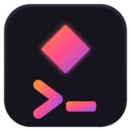
</p>

# re-code

A terminal-native AI coding agent for Linux, written in Rust. It is built to work properly with
**local models** first and to treat cloud models and external agents as equals later.

> **Status: Milestone 1 in progress.** `re-code` is a Claude Code-style agent for your own models. In a
> project folder, a tool-capable model reads, searches, edits and writes files — **anywhere on your
> computer, with your approval** — runs commands in a bubblewrap sandbox, and uses **your MCP servers,
> including the ones set up in Claude Code**, plus custom tools and skills. Type `/` for commands and `@` to
> mention a file; Ctrl+Z undoes a turn's file changes; sessions are saved (`re-code --continue`, or `/continue`
> to pick one) and long conversations are compacted. This is verified on local Ollama models; the cloud
> adapters (OpenAI-compatible and Anthropic) have tool-calling wired and unit-tested but not yet verified
> against a live cloud provider. Much of these documents still describes the plan.
>
> `re-code` is a working name. See decision D1 in [ARCHITECTURE](docs/ARCHITECTURE.md#decisions-needed).

## Install

Packages for Fedora and Debian/Ubuntu are on the [releases page](https://github.com/ZeroDay-Labz/Re-Code/releases):

```sh
sudo dnf install ./re-code-*.rpm      # Fedora
sudo apt install ./re-code_*.deb      # Debian, Ubuntu
```

Or build from source with a current stable Rust toolchain: `cargo install --path crates/app`. `bubblewrap` is
recommended (it sandboxes the commands the agent runs; `sudo dnf install bubblewrap`), and a running
[Ollama](https://ollama.com) with a tool-capable model is the usual starting point. Run `re-code` in a project
folder; `re-code doctor` explains what it found on the machine.

## A look around

Every screen below was captured from the real program (`scripts/screenshots/capture.sh`).

| | |
| --- | --- |
| **Home.** Local models with real sizes, what each declares (tools, vision, thinking) and whether it fits your GPU; live GPU and memory meters. 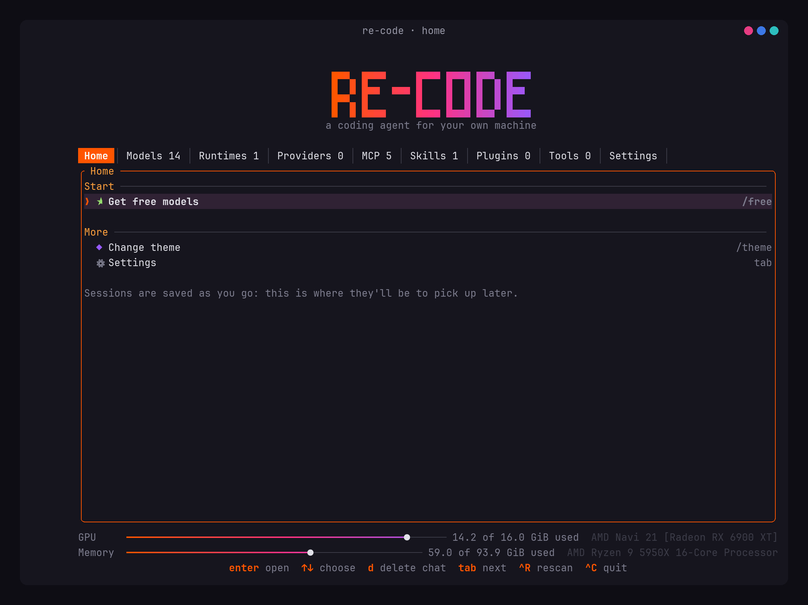 | **Models.** The models tab lists every model your runtime serves and estimates the context memory on top of the weights. 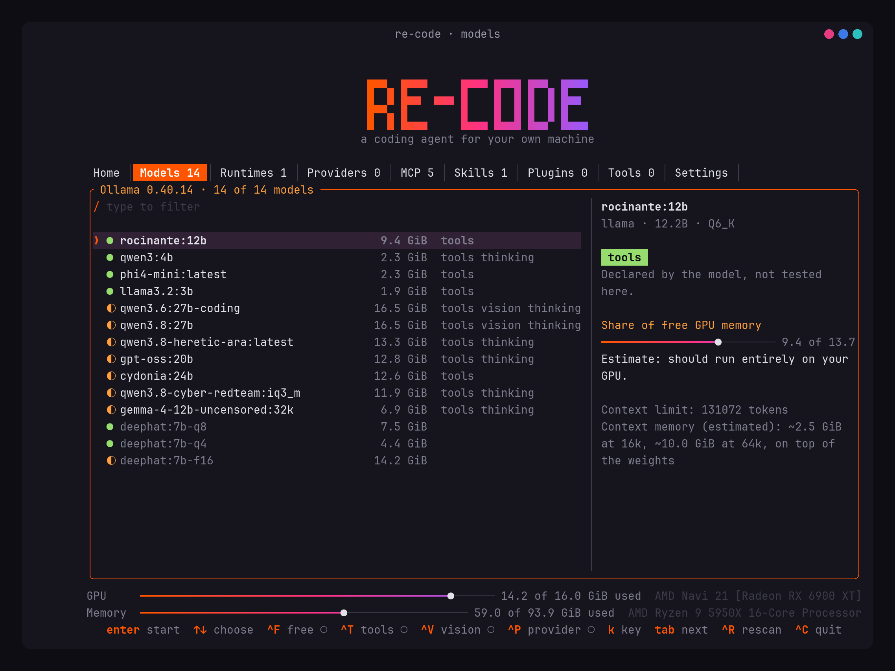 |
| **Approval.** Edits, writes, deletes and commands wait for you, with a live diff. `y` once, `a` for the session, `p` for the project. 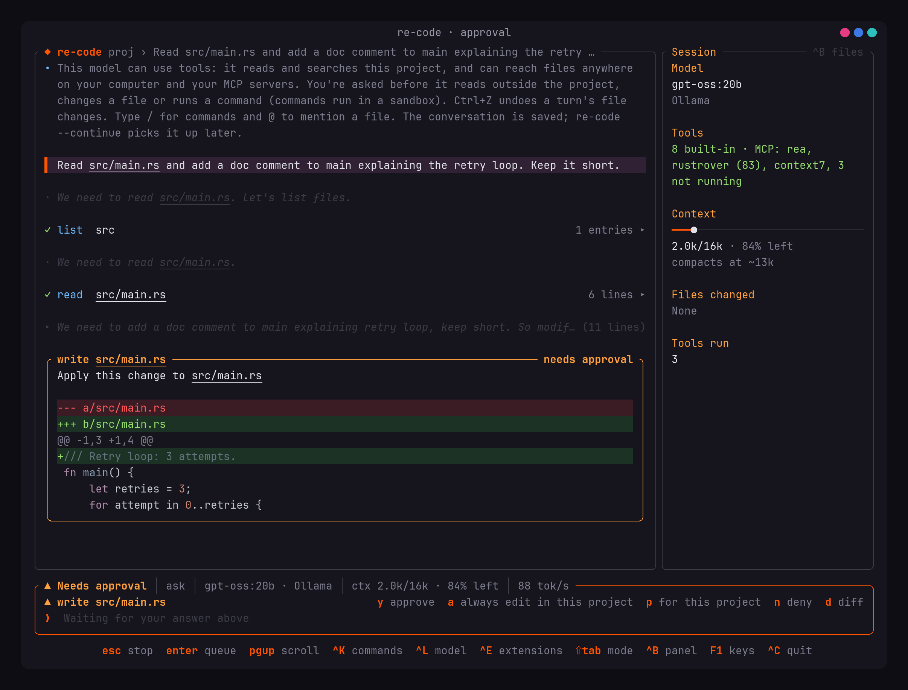 | **A turn.** Tool calls as rows, reasoning folded away, and a footer with provider-reported tokens, not estimates. 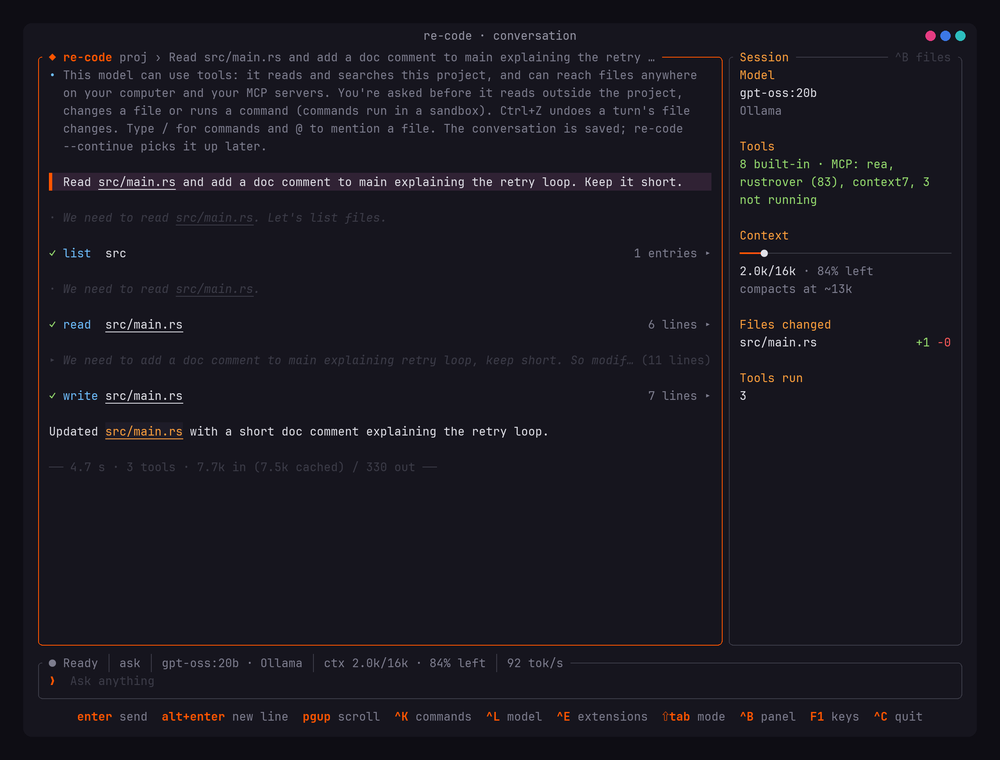 |
| **Runtimes.** Ollama, llama.cpp, vLLM and LM Studio found through podman, docker, systemd and the processes that are actually answering. 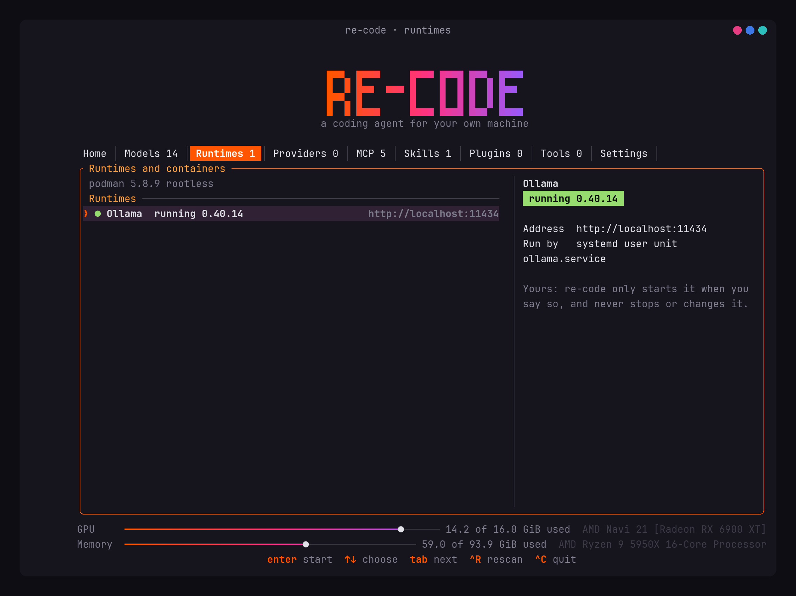 | **MCP.** Your servers, plus the ones already set up in Claude Code, used live; the registry is a search away. 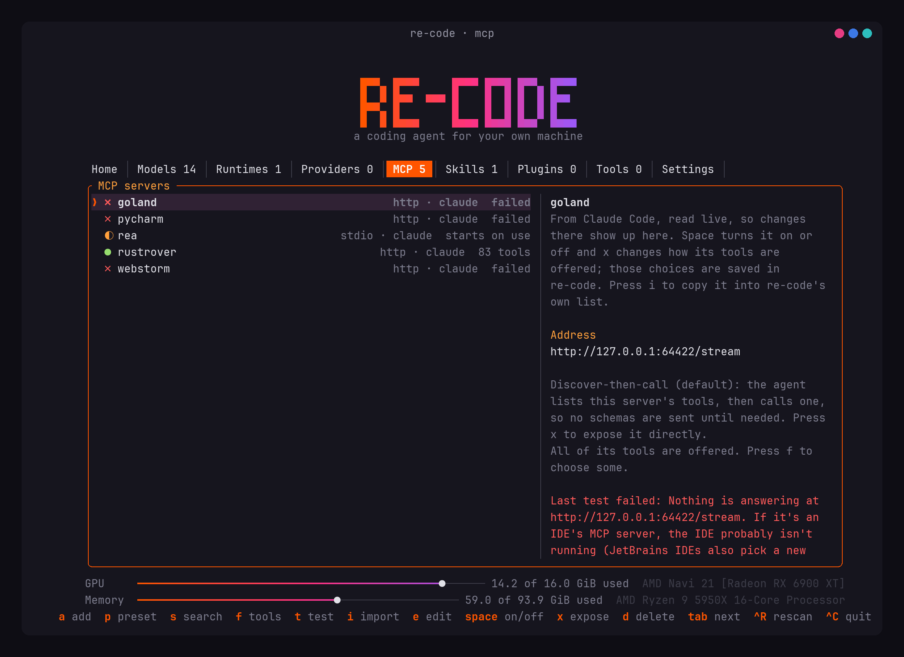 |
| **Skills from hubs.** `official/security/godmode`, a GitHub folder, a skills.sh link: fetched, scanned and shown before anything is installed. 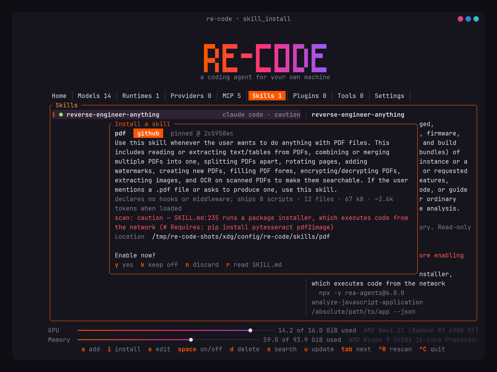 | **Plugins.** The Hermes catalog and Claude Code marketplaces; the preview says what runs here and what doesn't. 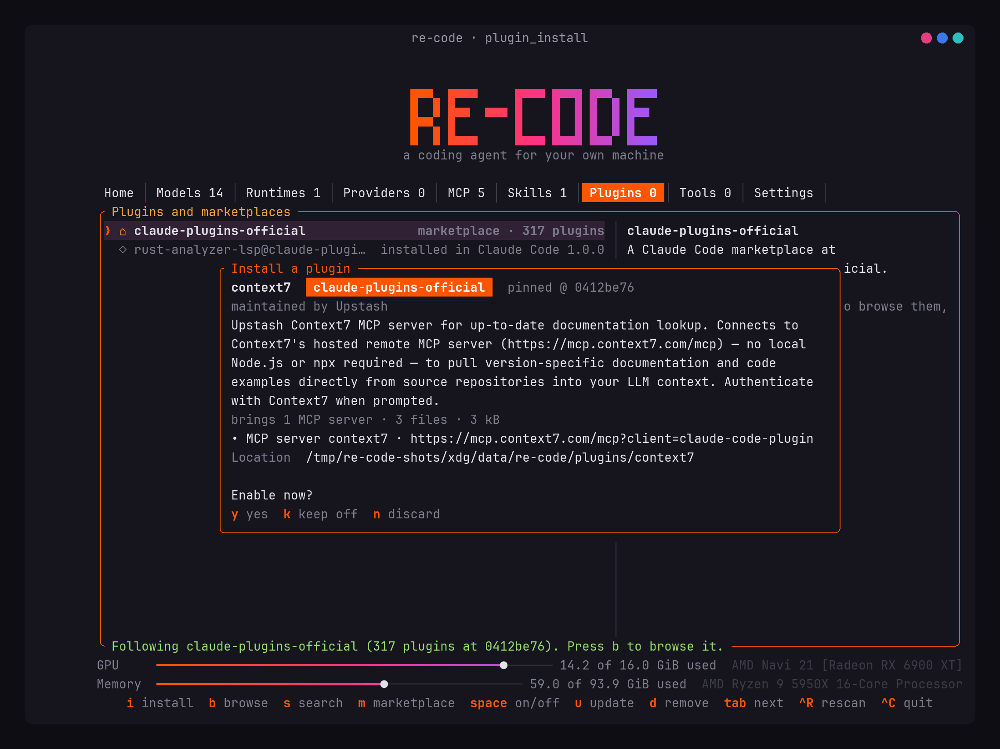 |
| **Plugins tab.** Installed plugins, followed marketplaces, and what Claude Code itself has installed. 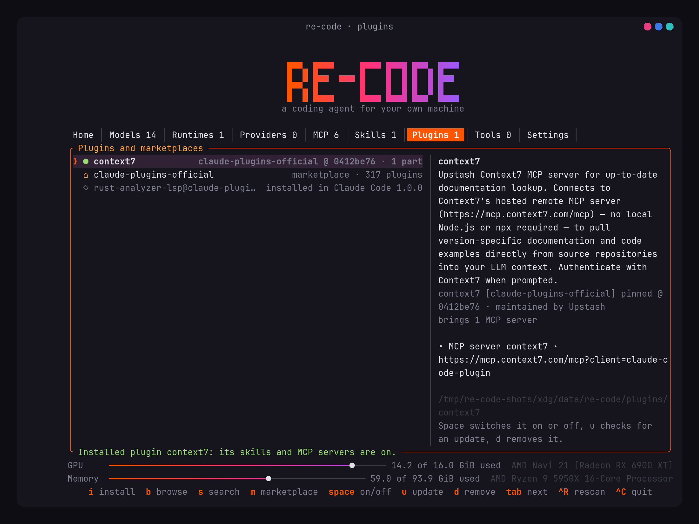 | **Skills.** Your skills, the project's (off until trusted), Claude Code's, and each one's scan verdict. 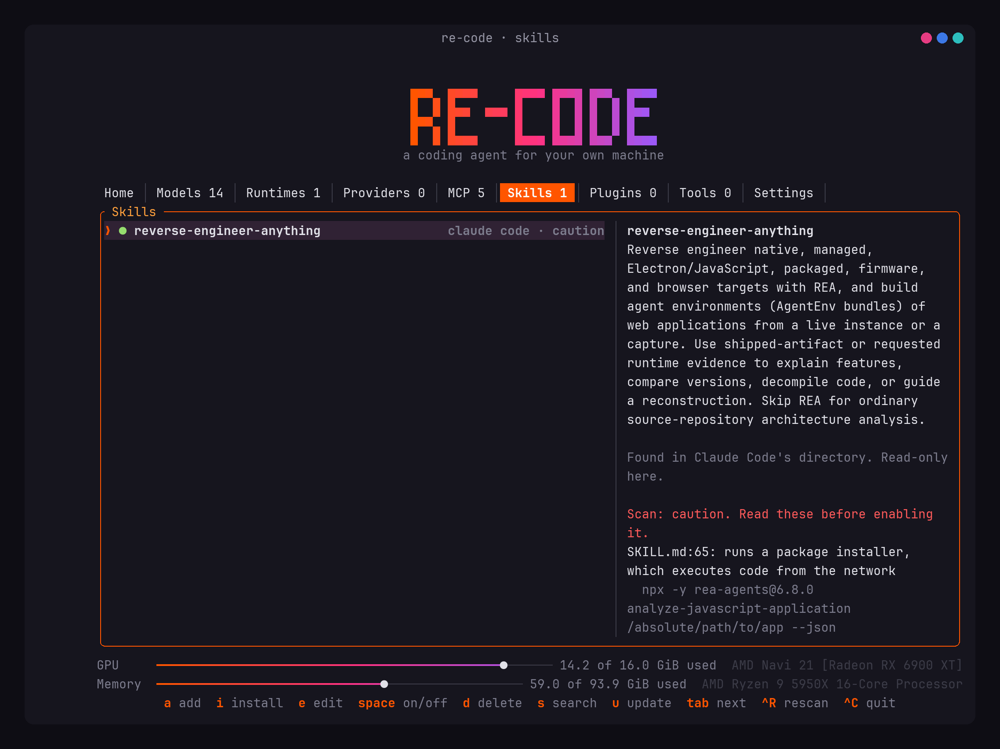 |
| **Context.** `/context` breaks the next request down part by part, so you know what the model is actually reading. 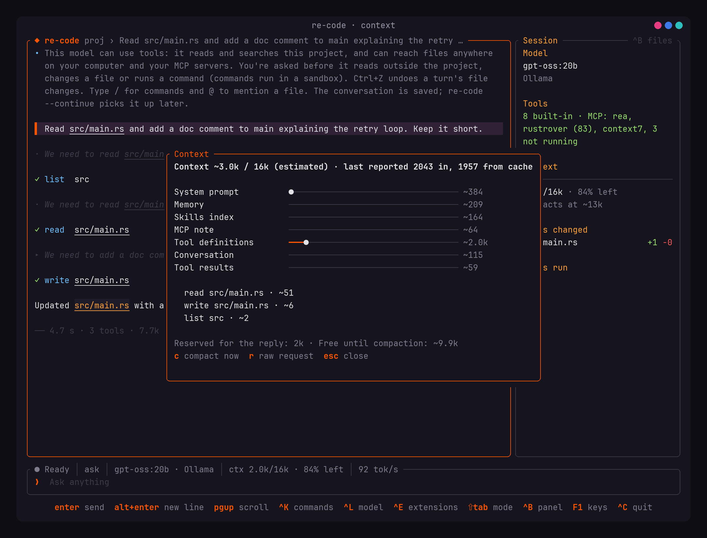 | **Palette and themes.** `Ctrl+K` for every command; eleven themes with dim and bright variants and your own theme files. 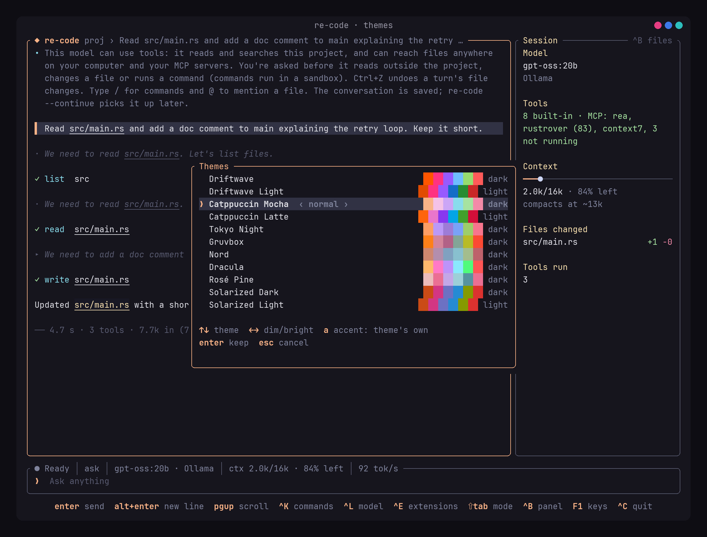 |

## What makes it different

Most local-model agents fail for reasons that have nothing to do with the model: prompts silently
truncated, 30-second model loads with no feedback, tool calls in a dialect the client can't parse,
and tens of thousands of tokens of overhead before the user has typed anything. re-code is designed
around those failures:

- **Every token is accounted for.** Each request has an itemised ledger, and estimated counts are
  always labelled separately from provider-reported ones.
- **Tool calling is measured, not assumed.** Models are probed with a conformance suite and the
  results decide how the agent talks to them.
- **It tells you what is actually happening.** "Loading model", "evaluating prompt" and "generating"
  are different states, and the interface shows which one you are in.
- **It respects what you already run.** It finds your existing runtimes and won't start, stop or
  change them without asking.

## Documentation

| Document | Covers |
| --- | --- |
| [PRODUCT_SPEC](docs/PRODUCT_SPEC.md) | Product understanding, defining features, non-goals, missing requirements |
| [ARCHITECTURE](docs/ARCHITECTURE.md) | Crates, dependencies, packaging, testing, **decisions needed** |
| [TUI_DESIGN](docs/TUI_DESIGN.md) | Interface model, layout, interaction, rendering |
| [PROVIDER_ARCHITECTURE](docs/PROVIDER_ARCHITECTURE.md) | Providers, runtimes, harnesses, capabilities |
| [HARDWARE_AND_RUNTIME](docs/HARDWARE_AND_RUNTIME.md) | Hardware detection, recommendations, runtime management |
| [AGENT_ENGINE](docs/AGENT_ENGINE.md) | Execution loop, tools, malformed calls, permissions flow |
| [CONTEXT_ENGINE](docs/CONTEXT_ENGINE.md) | Token ledger, budgeting, compaction, memory |
| [IDE_INTEGRATION](docs/IDE_INTEGRATION.md) | JetBrains MCP, ACP, plugin, IPC |
| [SECURITY](docs/SECURITY.md) | Threat model, sandboxing, credentials |
| [ROADMAP](docs/ROADMAP.md) | Milestones, risks, open questions |
| [MASTER_SPEC](docs/MASTER_SPEC.md) | The original full requirements |
| [Ollama spike](docs/spikes/2026-11-06-ollama.md) | Measured API behaviour and model test results |

**Providers:** local Ollama, plus cloud providers (Anthropic, OpenAI, Google Gemini, OpenRouter and any OpenAI-compatible server) added on the Providers tab with keys kept in the OS keyring. Tool use (files, shell, MCP, custom tools, skills) runs today on tool-capable local Ollama models; the same path is wired for cloud models but not yet live-verified.

## Development

Requires a stable Rust toolchain (developed on 1.99, edition 2024).

```bash
cargo run                                       # welcome screen and chat, needs Ollama
cargo run -- demo                               # the interface with a recording, no model needed
cargo run -- doctor                             # check this machine
./scripts/check.sh                               # formatting, lints, tests, licences
cargo test -p recode-providers -- --ignored      # live tests, needs Ollama with llama3.2:3b
```
